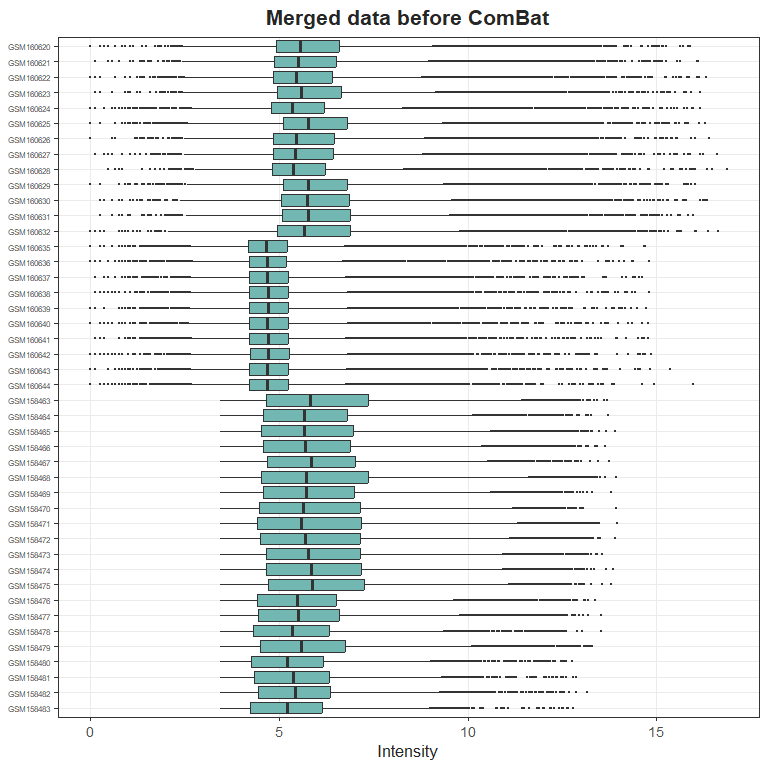
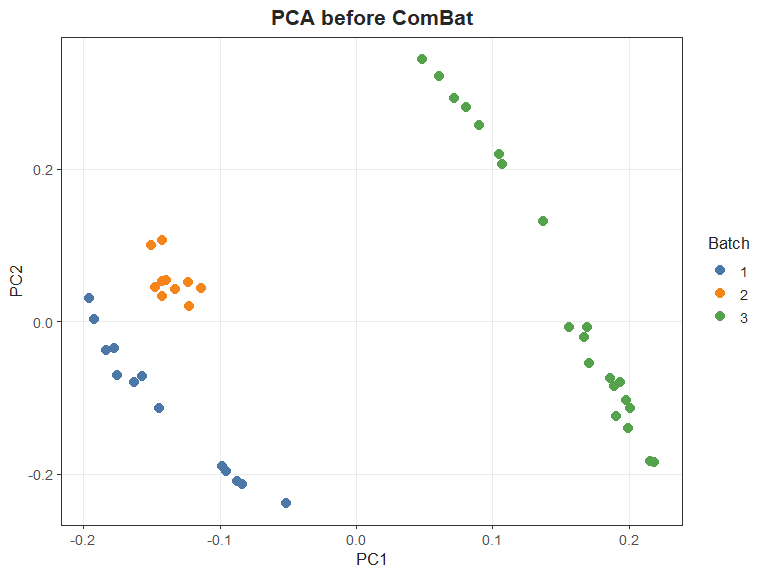
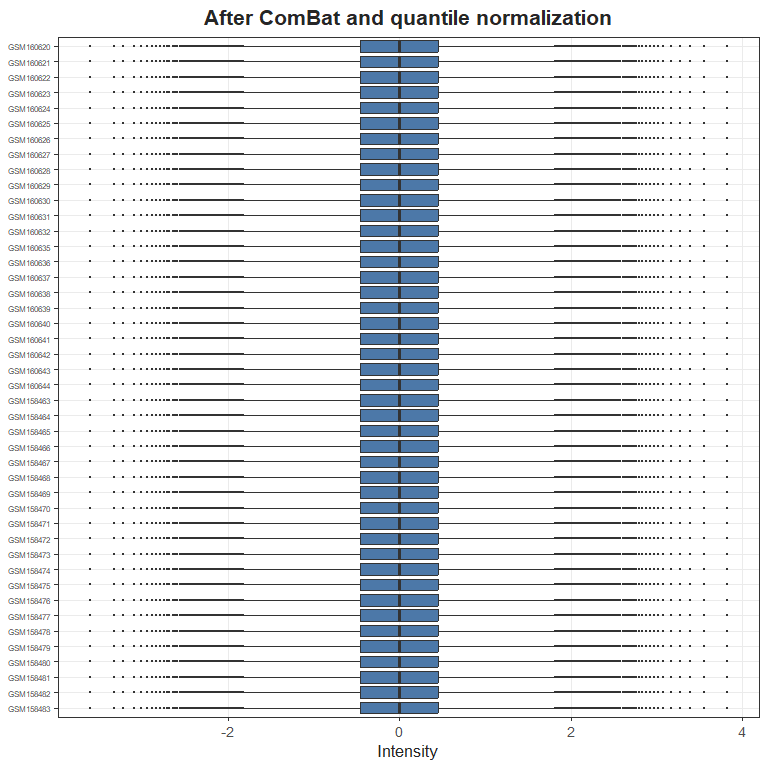
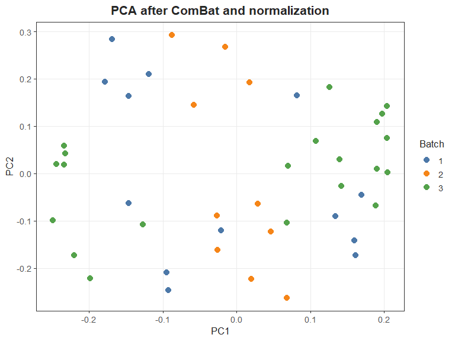
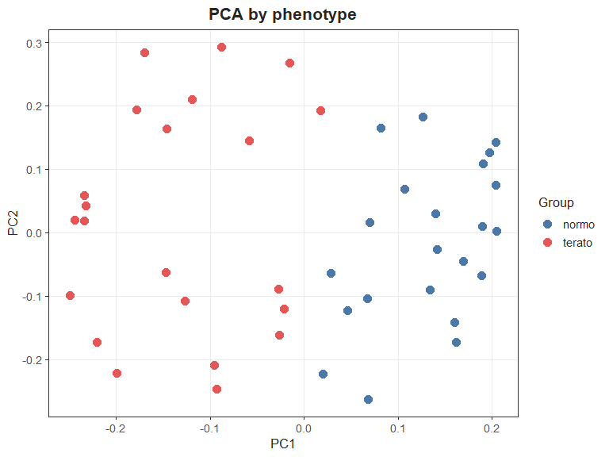
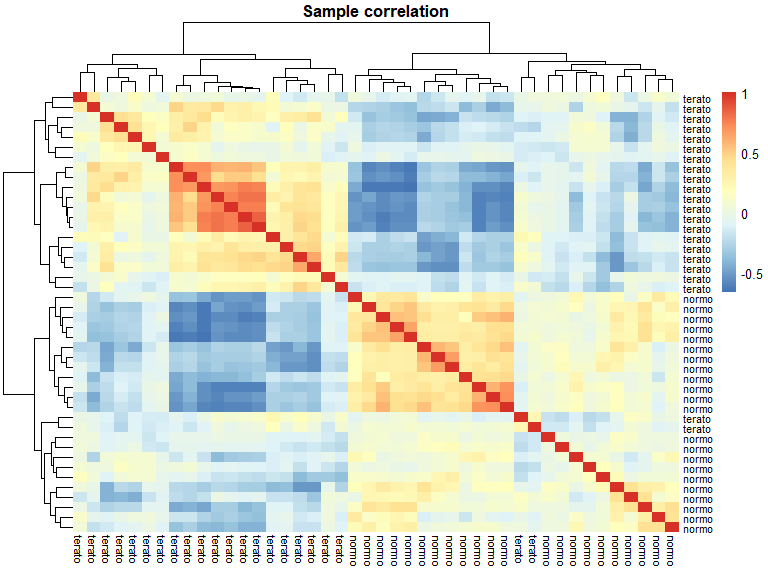
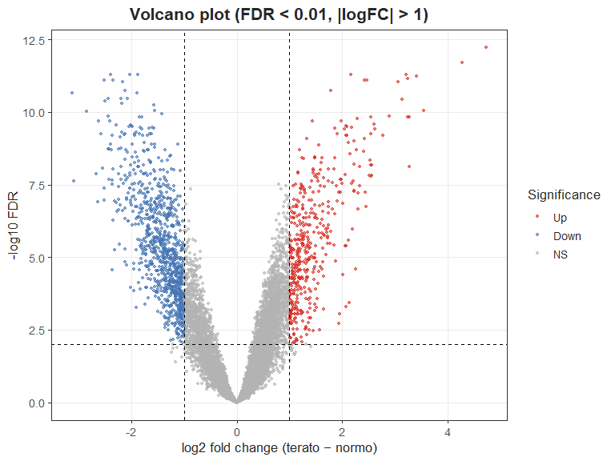

Dysregulated kinases in teratozoospermia
================
Seyedeh Zahra Mousavi
2026-09-19

- [Overview](#overview)
- [1. Packages](#1-packages)
- [2. Paths](#2-paths)
- [3. Read series matrices](#3-read-series-matrices)
- [4. Annotate probes and merge on GenBank
  accession](#4-annotate-probes-and-merge-on-genbank-accession)
- [5. Batch correction and quantile
  normalization](#5-batch-correction-and-quantile-normalization)
- [6. Phenotype labels](#6-phenotype-labels)
- [7. Differential expression](#7-differential-expression)
- [Session info](#session-info)

# Overview

Notebook version of the analysis accompanying:

> Mousavi SZ, Hadizadeh M, Mohammad Soltani B, Totonchi M.  
> Dysregulated kinase expression in teratozoospermia and implications
> for male infertility: an integrated gene expression study.  
> *Journal of Reproduction & Infertility*. 2025;26(4):224.  
> <https://doi.org/10.18502/jri.v26i4.21088>

**Steps:** annotate and merge three GEO microarray studies, ComBat batch
correction, quantile normalization, limma differential expression
(teratozoospermia vs normozoospermia).

Place these files in `data/` before running:

| File | Source |
|----|----|
| `GSE6967_series_matrix.txt` | [GSE6967](https://www.ncbi.nlm.nih.gov/geo/query/acc.cgi?acc=GSE6967) |
| `GSE6968_series_matrix.txt` | [GSE6968](https://www.ncbi.nlm.nih.gov/geo/query/acc.cgi?acc=GSE6968) |
| `GSE6872_series_matrix.txt` | [GSE6872](https://www.ncbi.nlm.nih.gov/geo/query/acc.cgi?acc=GSE6872) |
| `GPL2507.txt` | Platform for GSE6967 |
| `GPL2700.txt` | Platform for GSE6968 |
| `GPL570.txt` | Platform for GSE6872 |

Do not commit the raw series-matrix files to GitHub.

# 1. Packages

``` r
install.packages(c("data.table", "ggplot2", "pheatmap", "dplyr", "rmarkdown"))
if (!requireNamespace("BiocManager", quietly = TRUE)) {
  install.packages("BiocManager")
}
BiocManager::install(c("limma", "sva"))
```

``` r
library(data.table)
library(limma)
library(ggplot2)
library(sva)
library(pheatmap)
library(dplyr)

theme_set(
  theme_bw(base_size = 13, base_family = "Arial") +
    theme(
      text = element_text(family = "Arial", color = "grey15"),
      plot.title = element_text(face = "bold", hjust = 0.5),
      panel.grid.minor = element_blank()
    )
)
```

# 2. Paths

Run this notebook from the repository root so that `data/` and
`results/` are found.

``` r
data_dir <- "data"
out_dir <- "results"
dir.create(out_dir, showWarnings = FALSE)

needed <- c(
  "GSE6967_series_matrix.txt",
  "GSE6968_series_matrix.txt",
  "GSE6872_series_matrix.txt",
  "GPL2507.txt",
  "GPL2700.txt",
  "GPL570.txt"
)

missing <- needed[!file.exists(file.path(data_dir, needed))]
if (length(missing)) {
  stop(
    "Missing files in ", normalizePath(data_dir, mustWork = FALSE), ":\n  ",
    paste(missing, collapse = "\n  ")
  )
}
```

# 3. Read series matrices

``` r
data1 <- read.delim(file.path(data_dir, "GSE6967_series_matrix.txt"))
data2 <- read.delim(file.path(data_dir, "GSE6968_series_matrix.txt"))
data3 <- read.delim(file.path(data_dir, "GSE6872_series_matrix.txt"))

data1 <- na.omit(data1)
data2 <- na.omit(data2)

data1[, -1] <- log2(data1[, -1] - min(data1[, -1]) + 1)
data2[, -1] <- log2(data2[, -1] - min(data2[, -1]) + 1)
data3[, -1] <- log2(1 + data3[, -1])
```

# 4. Annotate probes and merge on GenBank accession

``` r
annot1 <- fread(file.path(data_dir, "GPL2507.txt"), data.table = FALSE)
annot2 <- fread(file.path(data_dir, "GPL2700.txt"), data.table = FALSE)
annot3 <- fread(file.path(data_dir, "GPL570.txt"), data.table = FALSE)

annot1$GB_ACC <- gsub("\\..*", "", annot1$GB_ACC)
annot2$GB_ACC <- gsub("\\..*", "", annot2$GB_ACC)

annot1 <- annot1[, c("ID", "GB_ACC")]
annot2 <- annot2[, c("ID", "GB_ACC")]
annot3 <- annot3[, c("ID", "GB_ACC")]

rownames(annot1) <- annot1$ID
rownames(annot2) <- annot2$ID
rownames(annot3) <- annot3$ID

data1$GB_ACC <- annot1[as.character(data1$ID_REF), "GB_ACC"]
data2$GB_ACC <- annot2[as.character(data2$ID_REF), "GB_ACC"]
data3$GB_ACC <- annot3[as.character(data3$ID_REF), "GB_ACC"]

data1 <- data1[, -1]
data2 <- data2[, -1]
data3 <- data3[, -1]

data1 <- aggregate(. ~ GB_ACC, data1, mean)
data2 <- aggregate(. ~ GB_ACC, data2, mean)
data3 <- aggregate(. ~ GB_ACC, data3, mean)

all1 <- merge(data1, data2, by = "GB_ACC")
all  <- merge(all1, data3, by = "GB_ACC")
all  <- subset(all, GB_ACC != "")

rownames(all) <- all$GB_ACC
all <- subset(all, select = -GB_ACC)
all <- data.matrix(all)
dim(all)
```

    ## [1] 10081    44

``` r
all_long <- stack(as.data.frame(all))
colnames(all_long) <- c("intensity", "sample")
all_long$sample <- factor(all_long$sample, levels = rev(colnames(all)))

ggplot(all_long, aes(x = sample, y = intensity)) +
  geom_boxplot(fill = "#72B7B2", color = "grey20", outlier.size = 0.3) +
  coord_flip() +
  labs(title = "Merged data before ComBat", x = NULL, y = "Intensity") +
  theme(axis.text.y = element_text(size = 6))
```

<figure>

<figcaption aria-hidden="true">Merged intensities before batch
correction</figcaption>
</figure>

# 5. Batch correction and quantile normalization

Batch is the study of origin. Sample counts come from each merged table
after dropping `GB_ACC`.

``` r
batch <- factor(c(
  rep(1, ncol(data1) - 1),
  rep(2, ncol(data2) - 1),
  rep(3, ncol(data3) - 1)
))

stopifnot(length(batch) == ncol(all))

allm <- all - rowMeans(all)
pc_before <- prcomp(allm)
pcr_before <- data.frame(pc_before$rotation[, 1:3], batch = batch)
```

``` r
ggplot(pcr_before, aes(PC1, PC2, color = batch)) +
  geom_point(size = 3) +
  scale_color_manual(values = c("#4C78A8", "#F58518", "#54A24B")) +
  labs(title = "PCA before ComBat", color = "Batch")
```

<figure>

<figcaption aria-hidden="true">PCA colored by study batch, before
ComBat</figcaption>
</figure>

``` r
allc <- ComBat(allm, batch)
```

    ## Found 17 genes with uniform expression within a single batch (all zeros); these will not be adjusted for batch.

``` r
allc <- normalizeQuantiles(allc)
```

``` r
after_long <- stack(as.data.frame(allc))
colnames(after_long) <- c("intensity", "sample")
after_long$sample <- factor(after_long$sample, levels = rev(colnames(allc)))

ggplot(after_long, aes(x = sample, y = intensity)) +
  geom_boxplot(fill = "#4C78A8", color = "grey20", outlier.size = 0.3) +
  coord_flip() +
  labs(title = "After ComBat and quantile normalization", x = NULL, y = "Intensity") +
  theme(axis.text.y = element_text(size = 6))
```

<figure>

<figcaption aria-hidden="true">After ComBat and quantile
normalization</figcaption>
</figure>

``` r
allm <- allc - rowMeans(allc)
pc_after <- prcomp(allm)
pcr_after <- data.frame(pc_after$rotation[, 1:3], batch = batch)

ggplot(pcr_after, aes(PC1, PC2, color = batch)) +
  geom_point(size = 3) +
  scale_color_manual(values = c("#4C78A8", "#F58518", "#54A24B")) +
  labs(title = "PCA after ComBat and normalization", color = "Batch")
```

<figure>

<figcaption aria-hidden="true">PCA colored by study batch, after
normalization</figcaption>
</figure>

``` r
allm <- as.data.frame(allm)
write.table(allm, file.path(out_dir, "allm.txt"))
```

# 6. Phenotype labels

Column order of the merged matrix must match this vector (same order as
the original script).

``` r
gr <- c(
  rep("terato", 5), rep("normo", 1),
  rep("terato", 3), rep("normo", 4),
  rep("terato", 6), rep("normo", 4),
  rep("normo", 13), rep("terato", 8)
)

stopifnot(length(gr) == ncol(allm))
table(gr)
```

    ## gr
    ##  normo terato 
    ##     22     22

``` r
exs <- t(scale(t(as.matrix(allm)), center = TRUE, scale = FALSE))
pc_grp <- prcomp(exs)
pcr_grp <- data.frame(
  PC1 = pc_grp$rotation[, 1],
  PC2 = pc_grp$rotation[, 2],
  Group = gr,
  sample = colnames(exs)
)

ggplot(pcr_grp, aes(PC1, PC2, color = Group, label = sample)) +
  geom_point(size = 3.5) +
  scale_color_manual(values = c(normo = "#4C78A8", terato = "#E45756")) +
  labs(title = "PCA by phenotype")
```

<figure>

<figcaption aria-hidden="true">PCA colored by teratozoospermia vs
normozoospermia</figcaption>
</figure>

``` r
pheatmap(
  cor(allm),
  labels_row = gr,
  labels_col = gr,
  border_color = NA,
  fontsize_row = 8,
  fontsize_col = 8,
  fontfamily = "Arial",
  main = "Sample correlation"
)
```

<figure>

<figcaption aria-hidden="true">Sample-to-sample correlation
heatmap</figcaption>
</figure>

# 7. Differential expression

Contrast: teratozoospermia − normozoospermia.  
DEG cutoffs in the original script: `|logFC| > 1` and FDR `< 0.01`.

``` r
gr <- factor(gr)
design <- model.matrix(~ gr + 0)
colnames(design) <- levels(gr)

fit <- lmFit(allm, design)
cont.matrix <- makeContrasts(terato - normo, levels = design)
fit2 <- contrasts.fit(fit, cont.matrix)
fit3 <- eBayes(fit2, 0.01)

tT <- topTable(fit3, adjust = "fdr", sort.by = "B", number = Inf)
tT$GB_ACC <- rownames(tT)
tT <- tT[, c("GB_ACC", "adj.P.Val", "logFC")]

write.csv(tT, file.path(out_dir, "terato-normo.csv"), row.names = FALSE)

updif   <- subset(tT, logFC > 1 & adj.P.Val < 0.01)
downdif <- subset(tT, logFC < -1 & adj.P.Val < 0.01)
alldif  <- rbind(updif, downdif)

write.csv(updif,   file.path(out_dir, "Up-DEGs1.csv"), row.names = FALSE)
write.csv(downdif, file.path(out_dir, "Down-DEGs1.csv"), row.names = FALSE)
write.csv(alldif,  file.path(out_dir, "all-DEGs1.csv"), row.names = FALSE)

nrow(updif)
```

    ## [1] 444

``` r
nrow(downdif)
```

    ## [1] 927

``` r
head(alldif)
```

    ##              GB_ACC    adj.P.Val    logFC
    ## NM_032785 NM_032785 5.861621e-13 4.741813
    ## NM_058165 NM_058165 1.916446e-12 4.282296
    ## NM_000840 NM_000840 5.199022e-12 3.212459
    ## NM_021220 NM_021220 5.199022e-12 2.169184
    ## NM_020403 NM_020403 5.878808e-12 3.414605
    ## NM_000451 NM_000451 7.115129e-12 3.250454

``` r
vol <- topTable(fit3, adjust = "fdr", sort.by = "none", number = Inf)
vol$sig <- "NS"
vol$sig[!is.na(vol$adj.P.Val) & vol$adj.P.Val < 0.01 & vol$logFC >  1] <- "Up"
vol$sig[!is.na(vol$adj.P.Val) & vol$adj.P.Val < 0.01 & vol$logFC < -1] <- "Down"
vol$sig <- factor(vol$sig, levels = c("Up", "Down", "NS"))

ggplot(vol, aes(x = logFC, y = -log10(adj.P.Val), color = sig)) +
  geom_point(alpha = 0.6, size = 1.1, na.rm = TRUE) +
  scale_color_manual(values = c(Up = "#D73027", Down = "#4575B4", NS = "grey70")) +
  geom_vline(xintercept = c(-1, 1), linetype = "dashed") +
  geom_hline(yintercept = -log10(0.01), linetype = "dashed") +
  labs(
    title = "Volcano plot (FDR < 0.01, |logFC| > 1)",
    x = "log2 fold change (terato − normo)",
    y = "-log10 FDR",
    color = "Significance"
  )
```

<figure>

<figcaption aria-hidden="true">Volcano plot, terato vs
normo</figcaption>
</figure>

``` r
allm_t <- as.data.frame(t(allm))
allm_t$id <- rownames(allm_t)
write.csv(allm_t, file.path(out_dir, "transposed_allm.csv"))

alldif$id <- alldif$GB_ACC
plotd <- allm[rownames(allm) %in% alldif$GB_ACC, , drop = FALSE]
write.csv(plotd, file.path(out_dir, "DEGs-Matrix.csv"))
```

# Session info

``` r
sessionInfo()
```

    ## R version 4.5.0 (2025-04-11 ucrt)
    ## Platform: x86_64-w64-mingw32/x64
    ## Running under: Windows 11 x64 (build 26100)
    ## 
    ## Matrix products: default
    ##   LAPACK version 3.12.1
    ## 
    ## locale:
    ## [1] LC_COLLATE=English_United States.utf8 
    ## [2] LC_CTYPE=English_United States.utf8   
    ## [3] LC_MONETARY=English_United States.utf8
    ## [4] LC_NUMERIC=C                          
    ## [5] LC_TIME=English_United States.utf8    
    ## 
    ## time zone: Europe/Berlin
    ## tzcode source: internal
    ## 
    ## attached base packages:
    ## [1] stats     graphics  grDevices utils     datasets  methods   base     
    ## 
    ## other attached packages:
    ##  [1] dplyr_1.2.1         pheatmap_1.0.13     sva_3.58.0         
    ##  [4] BiocParallel_1.44.0 genefilter_1.92.0   mgcv_1.9-4         
    ##  [7] nlme_3.1-168        ggplot2_4.0.3       limma_3.66.0       
    ## [10] data.table_1.18.6.1
    ## 
    ## loaded via a namespace (and not attached):
    ##  [1] KEGGREST_1.50.0       gtable_0.3.6          xfun_0.60            
    ##  [4] Biobase_2.70.0        lattice_0.23-1        vctrs_0.7.3          
    ##  [7] tools_4.5.0           generics_0.1.4        stats4_4.5.0         
    ## [10] parallel_4.5.0        tibble_3.3.1          AnnotationDbi_1.72.0 
    ## [13] RSQLite_3.53.3        blob_1.3.0            pkgconfig_2.0.3      
    ## [16] Matrix_1.7-3          RColorBrewer_1.1-3    S7_0.2.2             
    ## [19] S4Vectors_0.48.1      lifecycle_1.0.5       compiler_4.5.0       
    ## [22] farver_2.1.2          Biostrings_2.78.0     statmod_1.5.2        
    ## [25] Seqinfo_1.0.0         codetools_0.2-20      htmltools_0.5.9      
    ## [28] yaml_2.3.12           pillar_1.11.1         crayon_1.5.3         
    ## [31] cachem_1.1.0          locfit_1.5-9.12       tidyselect_1.2.1     
    ## [34] digest_0.6.39         labeling_0.4.3        splines_4.5.0        
    ## [37] fastmap_1.2.0         grid_4.5.0            cli_3.6.6            
    ## [40] magrittr_2.0.5        XML_3.99-0.24         survival_3.8-3       
    ## [43] edgeR_4.8.2           withr_3.0.3           scales_1.4.0         
    ## [46] bit64_4.8.4           rmarkdown_2.31        XVector_0.50.0       
    ## [49] httr_1.4.8            matrixStats_1.5.0     bit_4.6.0            
    ## [52] otel_0.2.0            png_0.1-9             memoise_2.0.1        
    ## [55] evaluate_1.0.5        knitr_1.51            IRanges_2.44.0       
    ## [58] rlang_1.3.0           xtable_1.8-8          glue_1.8.1           
    ## [61] DBI_1.3.0             BiocGenerics_0.56.0   rstudioapi_0.19.0    
    ## [64] annotate_1.88.0       R6_2.6.1              MatrixGenerics_1.22.0
